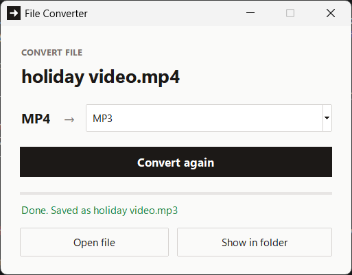

# File Converter

A Windows file converter that lives in the File Explorer right-click menu. Right-click a file, choose **Convert to...**, pick an output format, and the converted file is saved next to the original.



## How it works for the user

1. Right-click a supported file in Windows Explorer (on Windows 11, under **Show more options**).
2. Choose **Convert to...**.
3. A small window opens showing the file, the formats it can be converted to, and the name the new file will be saved as.
4. Choose a format and press **Convert** (or Enter). The window shows live progress, then **Open file** and **Show in folder** buttons.
5. If the output file already exists, the app asks before replacing it.

## Status

Working on Windows 11, and packaged as a single Windows installer, `FileConverter-Setup.exe`. This is a learning and portfolio project. The installer has been tested on my own PC and on a second Windows laptop, where Setup also downloaded and installed LibreOffice.

### Supported conversions

Every route below has been tested through the Explorer right-click workflow.

| Input | Output | Tool |
|---|---|---|
| MP4 | MP3, WAV | FFmpeg |
| MP3 | WAV | FFmpeg |
| WAV | MP3 | FFmpeg |
| PNG | JPG, WebP | FFmpeg |
| DOCX | PDF | LibreOffice |
| PPTX | PDF | LibreOffice |

Also tested: filenames and folder names containing spaces, and the overwrite confirmation.

## Installing

Download `FileConverter-Setup.exe` from the [latest release](https://github.com/abdullah200514/file-converter/releases/latest) and run it. It installs for the current user only, into `%LOCALAPPDATA%\Programs\File Converter`, and adds the **Convert to...** menu entries. You only need to run it once: the menu entries stay until you uninstall.

- **FFmpeg is included** in the installer, so audio, video and image conversion work straight away.
- **LibreOffice is needed for Word and PowerPoint.** It is too large to bundle, so if it is missing, Setup offers to download and install it (a 376 MB download that needs administrator approval). The download is pinned to one version and checked against its published SHA-256 before it is used. If you skip it, everything else still works. Installing LibreOffice is what makes Setup take several minutes; without it, Setup finishes in seconds.
- **The installer is unsigned**, so Windows SmartScreen may show "Windows protected your PC". Choose **More info**, then **Run anyway**. A code-signing certificate costs money and is not planned for now.

Uninstall from **Settings > Apps > Installed apps**. This removes the app and its menu entries. LibreOffice is a separate program, so it stays installed unless you remove it as well.

Requires 64-bit Windows 10 or 11.

## Architecture

The conversion engine is independent of the interface.

- `converter/convert.py` is the engine. `convert_file()` validates the input, looks up the tool in the `CONVERSIONS` table, runs it with `subprocess`, and returns the output path or raises a meaningful error. An optional `on_status` callback reports progress. `find_ffmpeg()` and `find_libreoffice()` locate the tools instead of assuming where they are installed: FFmpeg next to the packaged app first, then on PATH, and LibreOffice on PATH, then in the standard Program Files folders.
- `converter/gui.py` is a Tkinter window. It reads the supported formats from the same `CONVERSIONS` table, runs conversions on a background thread so the window stays responsive, and shows the engine's status messages.
- `installer/FileConverter.iss` is an [Inno Setup](https://jrsoftware.org/isinfo.php) script. It packages the PyInstaller build and FFmpeg, writes the menu entries under `HKCU`, and handles the optional LibreOffice download.
- `install_context_menu.ps1` and `uninstall_context_menu.ps1` are for development. They add and remove menu entries that run the source code through the virtual environment's `pythonw.exe`.

The actual conversion is done by existing tools, not custom code:

- [FFmpeg](https://ffmpeg.org/) for audio, video and images.
- [LibreOffice](https://www.libreoffice.org/) in headless mode for Office documents.

## Development setup

You need:

- Windows 10 or 11
- Python 3.10 or newer
- FFmpeg on PATH
- LibreOffice

Install the external tools with winget:

```powershell
winget install Gyan.FFmpeg
winget install -e --id TheDocumentFoundation.LibreOffice
```

The app itself uses only the Python standard library, so there are no packages to install to run it.

```powershell
git clone https://github.com/abdullah200514/file-converter.git
cd file-converter
python -m venv .venv
.venv\Scripts\Activate.ps1
```

To add development menu entries that run the source code:

```powershell
Set-ExecutionPolicy -Scope Process -ExecutionPolicy Bypass -Force
.\install_context_menu.ps1
```

Remove them again with `.\uninstall_context_menu.ps1`. The entries point at this folder's virtual environment, so run the installer again if you move the project. The development entries and the installed app use the same registry key, so only one of them can be active at a time: uninstall the app before adding the development entries, and run the uninstall script before installing the app.

## Building the installer

1. Install the build tools:

   ```powershell
   pip install pyinstaller
   winget install --id JRSoftware.InnoSetup -e
   ```

2. Build the app in PyInstaller's folder mode. This starts faster than `--onefile`, because the app is not unpacked on every launch:

   ```powershell
   pyinstaller --noconfirm --windowed --name FileConverter converter\gui.py
   ```

3. Put FFmpeg in `vendor\ffmpeg\`. This folder is ignored by Git because `ffmpeg.exe` is too large for GitHub. Download the exact build listed in `installer/THIRD_PARTY_NOTICES.txt`, check its SHA-256, and copy these files in:
   - `ffmpeg.exe`, from the build's `bin` folder
   - `LICENSE.txt`, from the build
   - `GPL-3.0.txt`, the GNU GPL version 3 text, which the LGPLv3 builds on

4. Compile the installer. With a per-user Inno Setup install, the compiler is here:

   ```powershell
   & "$env:LOCALAPPDATA\Programs\Inno Setup 6\ISCC.exe" installer\FileConverter.iss
   ```

The result is `installer_output\FileConverter-Setup.exe`.

The bundled FFmpeg is an LGPL build, which leaves out GPL-only parts such as x264 that this app does not need. Licences and source locations for third-party software are in `installer/THIRD_PARTY_NOTICES.txt`, which the installer copies into the app folder.

## Command-line use

The engine also works without the GUI:

```powershell
python converter\convert.py "path\to\video.mp4" mp3
python converter\convert.py "path\to\document.docx" pdf
```

To open the GUI directly:

```powershell
python -m converter.gui "path\to\file.mp4"
```

## Running tests

```powershell
python -m unittest discover -s tests -v
```

The five tests cover missing arguments, a nonexistent input file, an unsupported conversion, MP4 to WAV, and DOCX to PDF. The MP4 test generates its own one-second file with FFmpeg, and the DOCX fixture is in `tests/fixtures/`. FFmpeg and LibreOffice must be installed for the integration tests to pass.

The GUI, the Explorer integration and the installer are tested manually.

## Project structure

```text
file-converter/
├── converter/
│   ├── __init__.py
│   ├── convert.py
│   └── gui.py
├── docs/
│   └── screenshot.png
├── installer/
│   ├── FileConverter.iss
│   └── THIRD_PARTY_NOTICES.txt
├── tests/
│   ├── fixtures/
│   │   └── test.docx
│   └── test_convert.py
├── samples/                       # local test files, excluded from Git
├── vendor/                        # bundled FFmpeg, excluded from Git
├── install_context_menu.ps1
├── uninstall_context_menu.ps1
├── .gitignore
├── README.md
└── requirements.txt
```

## How this was built

I used Claude (an AI assistant) throughout this project, mainly as a learning tool. It explained the concepts and the reasoning behind each step, and I worked through the engine step by step, making changes and testing them myself.

The front end is different: **the GUI (`converter/gui.py`) was written by Claude.** The design direction was mine. I chose the minimal look, the "from → to" layout, the live status messages instead of popups, the Open file and Show in folder buttons, and asking before overwriting an existing file. I also tweaked parts of the code myself. I tested each version through the real Explorer right-click workflow and sent back screenshots and errors until it matched what I wanted.

**The packaging was also done by Claude**, because I did not know how to do it myself. That covers the Inno Setup installer, bundling FFmpeg, and the optional LibreOffice download. Claude taught me what each step did and why as we went. The decisions behind it were made together: folder mode instead of a single-file build, a per-user install so no administrator rights are needed, an LGPL build of FFmpeg instead of a GPL one, and offering LibreOffice rather than bundling 350 MB of it.

I'm being upfront about this because I want the repo to show what I built and what I'm still learning. The problems I hit and fixed along the way are in the commit messages. Examples: a console window appearing on every conversion, a stale file causing a keyword-argument error, and a progress bar that left a block behind after finishing.

## Planned

- Logging.
- More audio, video, image and document formats.
- PDF to editable DOCX and OCR for scanned PDFs.
- Batch conversion.
- The short Windows 11 right-click menu, without **Show more options**.

## Author

Built by Muhammad Abdullah as a learning and portfolio project.
